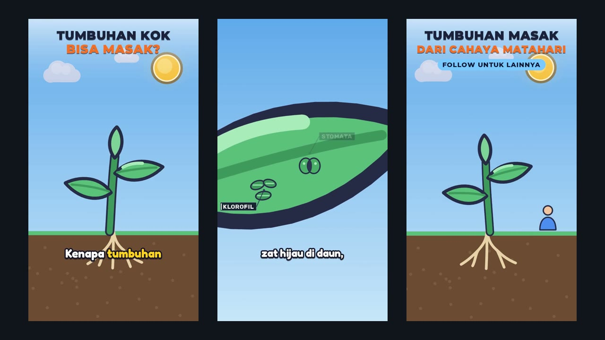

# Motion 2D Explainer

Skill Claude untuk membuat **video explainer motion 2D bergaya flat-vector** untuk topik apa pun, langsung dari chat Claude di browser. Kasih topik, naskah, atau rekaman suara, lalu Claude menyusun dunia ilustrasinya, merender video, dan memberimu file MP4.



Panduan lengkap dan contoh video: https://www.mujay.web.id/lab/motion-2d-explainer

## Fitur

- Ilustrasi vektor flat: warna solid, satu bayangan, satu highlight, garis tepi membulat
- Satu take kamera: pan dan zoom antar-bahasan, lalu "menyelam" ke level mikro (sel, molekul)
- Animasi proses: aliran, benda berpindah, transformasi, hitungan angka, kartu perbandingan
- Caption 2–4 kata dengan kata kunci yang menyala kuning saat diucapkan, plus file `.srt`
- Latar mengikuti topik: `space`, `body`, `blueprint`, `kids`, `peach`, `chalkboard`, dan lainnya
- Efek suara otomatis, plus ambience hujan atau angin kalau adegannya cocok
- Format 9:16, 16:9, 1:1, atau 4:5 dalam 720p atau 1080p
- Input berupa topik, naskah, atau voice over (ditranskrip offline dengan Whisper)

## Pasang di Claude (browser)

Tidak perlu install apa pun di komputermu.

1. Klik **Code → Download ZIP** di halaman ini. File ZIP tidak perlu diekstrak.
2. Di [claude.ai](https://claude.ai), buka **Settings → Capabilities**.
3. Aktifkan **Code execution and file creation**.
4. Di bagian **Skills**, klik **Upload skill**, lalu pilih file ZIP tadi.

## Cara pakai

Buka chat baru, lalu minta dengan kalimat biasa:

```text
Bikin video motion 2D explainer tentang kenapa laut asin, 60 detik, format 9:16.
```

Claude akan menanyakan pengaturan video sekali, menulis naskah kalau perlu, merender, lalu memberi file MP4 untuk diunduh.

## Isi repository

| Path | Isi |
| --- | --- |
| `SKILL.md` | Instruksi untuk Claude |
| `engine/explainer.py` | Mesin render (Python) |
| `engine/svgkit.py`, `engine/sfx.py` | Gambar SVG gaya flat dan efek suara prosedural |
| `engine/whisper_ort.py` | Transkrip voice over offline (Whisper base, onnxruntime) |
| `engine/SPEC_REFERENCE.md` | Katalog latar, objek, aksi, dan layout |
| `engine/examples/` | Contoh spec: fotosintesis, roti, tata surya, dan preset format |
| `engine/fonts/` | Fredoka, Montserrat, Rubik (SIL Open Font License 1.1) |

## Lisensi

Kode di repository ini memakai lisensi [MIT](LICENSE). Font di `engine/fonts/` memakai SIL Open Font License 1.1.
